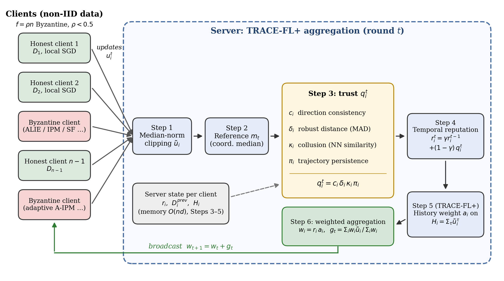

# TRACE-FL: Byzantine-Robust Federated Learning under Non-IID Data

Official implementation of the paper *Temporal Reputation Aggregation with Collusion Detection and Trajectory Persistence for Robust Federated Learning against Byzantine Clients with Heterogeneous Data*: **TRACE-FL** (Temporal Reputation Aggregation with Clipping and collusion-aware Estimation) and its history-aware extension **TRACE-FL+**, root-free server-side aggregation rules that defend federated learning against Byzantine (poisoning) clients when client data is non-IID.

TRACE-FL needs **no clean server dataset**, **no knowledge of the number of attackers** and **no client-side changes**. Everything runs in NumPy on a single CPU core; an optional JAX script trains an end-to-end CNN on a GPU.

<p align="center"></p>

## How it works

Each round, the server turns the received client updates into a trust-weighted average in six steps:

| Step | Operation | Purpose |
| --- | --- | --- |
| 1 | Clip every update to the median norm | Neutralises scaling attacks; bounds every update by an honest norm (Lemma 1) |
| 2 | Reference `m` = coordinate-wise median | Robust estimate of the honest direction |
| 3 | Trust `q_i = c_i · δ_i · κ_i · π_i` | Direction consistency, robust (MAD) distance, **collusion** (nearest-neighbour similarity) and **trajectory persistence** |
| 4 | Reputation `r_i ← γ r_i + (1 − γ) q_i` | Attackers that must persist lose weight geometrically |
| 5 | FoolsGold-style weight `a_i` on cumulative *clipped* histories (TRACE-FL+ only) | Fresh adaptive noise averages out over time |
| 6 | `g = Σ w_i ũ_i / Σ w_i`, with `w_i = r_i · a_i` | Weighted aggregation |

`tracefl` implements Steps 1–4 (with `a_i = 1`); `tracefl_plus` implements all six steps and is the proposed method.

## Installation

```bash
git clone https://github.com/iitrky/trace-fl.git
cd trace-fl
pip install -r requirements.txt
python -m pytest -q                      # 20 unit tests, < 1 s, no downloads
```

Python ≥ 3.9. Datasets are downloaded automatically on first use into `data/` (override with `TRACEFL_DATA=/path`):

| Dataset | Source | Size |
| --- | --- | --- |
| Fashion-MNIST | official [zalandoresearch](https://github.com/zalandoresearch/fashion-mnist) repository | 30 MB |
| UCI Digits | bundled with scikit-learn | – |
| CIFAR-10 | [image mirror](https://github.com/YoongiKim/CIFAR-10-images) → `cifar10.npz`, then frozen k-means features (built once, ~3–5 min) | 56 MB |

## Quick start

```bash
# one configuration: TRACE-FL+ on Fashion-MNIST, 40% adaptive IPM attackers, 2 seeds
python experiments/run.py --dataset fmnist --agg tracefl_plus --attack aipm --byz 0.4 --seeds 0 1

# ablation: TRACE-FL without the collusion factor
python experiments/run.py --dataset fmnist --agg tracefl --attack ipm --byz 0.4 --no-coll
```

```python
from tracefl import run_fl
res = run_fl("digits", "tracefl_plus", attack="sign", frac_byz=0.2, seed=0)
print(res["acc"], res["rep_byz"], res["rep_ben"])
```

**Aggregators:** `tracefl_plus`, `tracefl`, `fedavg`, `krum`, `median`, `trmean`, `cclip`, `fltrust`, `bulyan`, `foolsgold`, `rfa`

**Attacks:** `none`, `lflip` (label flip), `sign` (sign flip), `gauss`, `alie`, `ipm`, `scale` (scaled label flip), `aalie` / `aipm` (adaptive, defence-aware), `aalief` / `aipmf` (adaptive with fixed per-attacker noise, fakes persistence)

## Reproducing the paper

```bash
python experiments/reproduce.py --list                     # tables and run counts
python experiments/reproduce.py --table table3             # one table
python experiments/reproduce.py --table all --workers 8    # everything (up to 818 runs; shared runs computed once)
```

Runs are cached in `results/runs.json`, so interrupted jobs resume and shared runs are computed once. Single-core CPU time is about 8 s per Fashion-MNIST run, 1 s per Digits run and 40–60 s per CIFAR-10 run. The package reproduces the paper's reported numbers exactly (bit-identical seeds and random-number order).

| Script table | Paper content |
| --- | --- |
| `table3`, `table4` | Standard attacks on Fashion-MNIST (2 seeds) and Digits (3 seeds) |
| `table5a`, `table5b` | CIFAR-10 (seed 0) and 3-seed robustness check |
| `table6` | Adaptive attacks A-ALIE / A-IPM at 20% and 40% |
| `table7` | Heterogeneity (α) and attacker-fraction sweeps |
| `table8` | Six-variant ablation with Byzantine weight share |
| `table9` | Extra baselines: FoolsGold, RFA, Bulyan |
| `table10` | TRACE-FL vs TRACE-FL+ |
| `table11` | Persistence-faking attacks (negative result) |

### End-to-end CNN (GPU)

```bash
pip install -U "jax[cuda12]"
python cnn/cnn_cifar10.py --seeds 0 1 2 3 4 --rounds 100
```

## Key results (40 clients, Dirichlet α = 0.5)

| Setting | TRACE-FL+ | Best other method |
| --- | --- | --- |
| CIFAR-10, 20% attackers, avg / worst over 5 attacks | **60.8 / 59.8** | CClip 59.5 / 56.2 |
| Digits, 20% attackers, avg / worst over 6 attacks | 87.7 / **86.6** | CClip 86.6 / 82.6 (root-free) |
| Fashion-MNIST, 20% attackers, avg / worst | 81.9 / 80.9 | CClip 82.0 / 81.1 |
| Fashion-MNIST, adaptive IPM, 40% attackers | 75.1 | FoolsGold 82.4 |
| CIFAR-10, adaptive IPM, 40% attackers (3 seeds) | 47.0 | FLTrust* 54.0 |

\*FLTrust uses a clean server-side root dataset; TRACE-FL does not.

### Limitations

We report these openly (Section 7.8 of the paper):

- With 40% colluding adaptive attackers, FoolsGold and clean-root FLTrust outperform TRACE-FL+. FoolsGold, however, collapses under sign flipping (worst case 5–9%).
- A **persistence-faking** attack (fixed noise per attacker, `aalief` / `aipmf`) defeats both TRACE variants at 40% attackers (73.5% vs 81.3% for FedAvg). This is consistent with known lower bounds for Byzantine robustness under heterogeneity. Closing the gap needs extra information, such as a small validation set.
- The CIFAR-10 results in the paper use frozen unsupervised features; `cnn/cnn_cifar10.py` provides the end-to-end CNN version.

## Repository layout

```
trace-fl/
├── tracefl/                 # the package
│   ├── aggregators.py       # TRACE-FL, TRACE-FL+ and 9 baselines
│   ├── attacks.py           # 10 attacks incl. adaptive and persistence-faking
│   ├── simulation.py        # federated training loop (run_fl)
│   ├── models.py            # NumPy MLP + local SGD
│   ├── data.py              # downloads, loaders, Dirichlet split
│   └── features.py          # CIFAR-10 k-means feature extractor
├── experiments/
│   ├── run.py               # single-configuration CLI
│   └── reproduce.py         # all paper tables
├── cnn/cnn_cifar10.py       # end-to-end JAX CNN (GPU)
├── figures/make_fig1.py     # Fig. 1 system diagram
├── tests/test_tracefl.py    # unit tests
├── data/  results/          # created on demand (git-ignored)
├── requirements.txt  pyproject.toml  LICENSE  CITATION.cff
```

## Citation

```bibtex
@article{dalton2026tracefl,
  title   = {Temporal Reputation Aggregation with Collusion Detection and Trajectory Persistence
             for Robust Federated Learning against Byzantine Clients with Heterogeneous Data},
  author  = {Dalton, Gregory Arul},
  journal = {Under review},
  year    = {2026}
}
```

## License

MIT, see [LICENSE](LICENSE).
